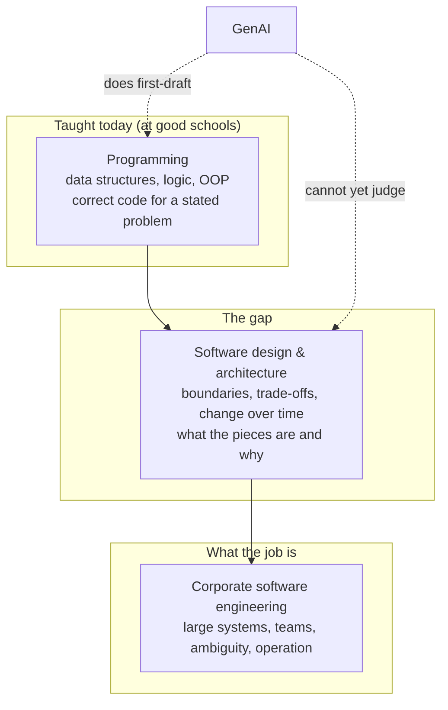
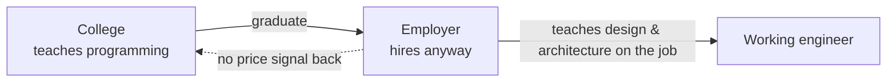
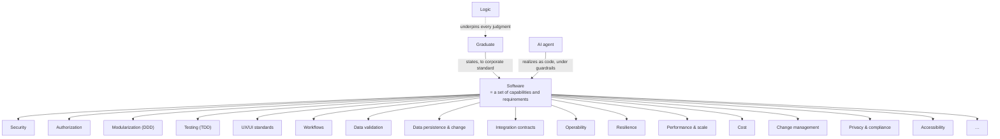
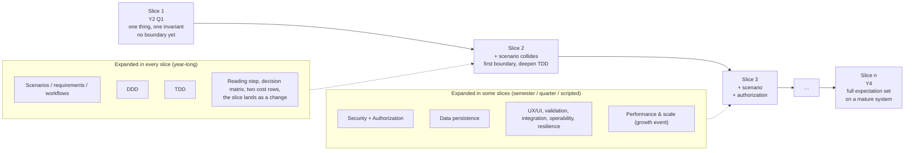
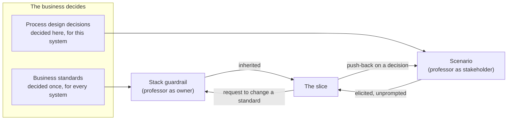

# Brainstorm: College Computer Science Curriculum in the GenAI Era

**Status**: EXPLORING
**Owner**: David Cornelson
**Started**: 2026-09-24
**Compiled from**: conversation only
**Detail**: this folder also holds the per-expectation deep dives (`expectations/`), the curriculum's own decision records (`decisions/`, not ADRs), `risks.md`, and `README.md` as the roster index

One-line vision: **A CS degree whose product is design judgment grounded in logic: graduates who can state what acceptable working software is, to the corporate standard, and hold an AI agent to it.**

## Brainstorm Progress

- [x] **Problem & Vision** — What problem does this solve? Who has this problem? What does success look like?
- [x] **Core Concepts** — Key entities, terms, and relationships in the domain (expectation set closed by verdict 2026-09-27, 19 of 19; vocabulary in `docs/brainstorm/cs-curriculum-genai-era/`)
- [ ] **User Activities** — What do users actually do? Workflows, interactions, jobs-to-be-done
- [x] **Structural Patterns** — How are things organized? Hierarchies, categories, lifecycles, states
- [ ] **Competitive Landscape** — What exists today? Where do they fall short? What's the differentiation?
- [ ] **Tech Stack** — Languages, frameworks, infrastructure, data stores, protocols → `techstack.md`
- [ ] **Architecture** — Layers, boundaries, hosting model, data ownership, integration points → `techstack.md`
- [ ] **Role Assessments** — Evaluate the design from stakeholder perspectives → `{role}-assessment.md` per role
- [ ] **Thought Exercises** — Stress-test with concrete scenarios: "What does this look like for [specific use case]?" (TE-1 and TE-2 done; a year-one and a year-four walk still wanted)
- [ ] **Revenue & Business Model** — How does this make money? Pricing, tiers, monetization strategy
- [ ] **MVP Scope** — What ships first? What's explicitly out of scope? What's the minimal working loop?
- [ ] **Open Questions** — Unresolved decisions, unknowns, things to research

## Problem & Vision

### The problem (as stated 2026-09-24)

- CS programs are inefficient even before GenAI is considered. Most programmers learn the job on the job.
- Outside a very small number of schools, corporate-level software engineering is almost unrecognizable to a fresh CS graduate. The degree teaches something adjacent to the work, not the work.
- GenAI widens the gap rather than creating it: the parts of the degree that map most directly to entry-level work (writing code from a spec) are the parts a model now does first-draft.

### What the degree already does, and what it does not

- Some colleges do teach data structures, logic, and object-oriented programming well. But that is **programming**: producing correct code for a given problem.
- What corporate engineering runs on is **software design and architecture**: deciding what the pieces are, where the boundaries go, how the system changes over time, and what the trade-offs cost. That is the layer a graduate does not recognize, because it was never taught.
- GenAI sharpens the split. Programming is the layer the model now does first-draft. Design and architecture is the layer that decides whether what the model produced belongs in the system at all.



_Caption: the degree stops at the first box. The job lives in the third. The second box is the missing curriculum, and it is also the box GenAI does not fill._

### Why the gap persisted

- Colleges escaped scrutiny because the corporate world accepted candidates from this structure. Employers hired programming-trained graduates, absorbed the cost of teaching design and architecture on the job, and never sent a price signal back to the college.
- So the gap is not a failure of faculty capability or curriculum design. It is an equilibrium: the college sells programming, the employer buys it and finishes the education itself, and nobody at either end is paid to close the loop.



_Caption: the loop that let the gap persist. The employer's willingness to finish the education is what kept the college from having to._

### What GenAI does to the taught layer

- Stated position (2026-09-24, corrected same day): in the GenAI world, programming and to some degree data structures are significantly less relevant. **Logic is not on that list. Logic is still a premium**: it is the faculty that judges whether the model's output is right, and it underpins design.
- The "to some degree" on data structures is deliberate: choosing the right structure is a design decision and survives; implementing it does not.

| Layer | Pre-GenAI | GenAI era |
|---|---|---|
| Logic | taught, valued | **premium** — the judging faculty |
| Data structures | taught as implementation | choice and cost stay; implementation goes |
| Programming | the core product | done by model under guardrails; reading it is not the verdict, but eyes on the results are taught (Q-1, amended 2026-09-27) |
| Design & architecture | untaught | the missing core |
- Q-1 resolved 2026-09-24: **reading code is pointless** when the LLM operates under proper software engineering guardrails. The guardrails do the judging that a human reader used to do: TDD, where a failing test is the verdict on the model's code; and an agent held to DDD engineering principles, so boundaries and invariants are enforced by the process rather than inspected by eye. DevArch is the working example.
- Consequence for the curriculum: the human's artifact is no longer code and no longer a reading of code. It is the **behavior statement**, the **test that encodes it**, and the **boundary the agent is held to**. Those are what the graduate must be able to author. Logic is what makes them right.
- Q-1 amended 2026-09-27: **students must still learn to read code, as eyes on the results.** LLMs are non-deterministic, so the graduate is taught never to trust the output completely, including the output that passed its guardrails. Reading is not the verdict (the test is) and not the graduate's artifact (the behavior statement, test, and boundary are). It is the habit of looking at what the agent produced before accepting that the guardrails caught everything. **The reading is at the level of classes and interfaces, not inner code** (loops, branches, conditionals): the test judges behavior, and inner code is where non-determinism produces the defects a test catches; the eyes judge structure, which is where the agent produces something that passes every test and still does not belong in the system, and which no test catches. Writing inner code is not taught. The reading serves two purposes, stated 2026-09-27: **bounded context and complexity** (reading the structure to decide whether a boundary is present, warranted, or drawn only to look diligent; feeds modularization and decision college-0003) and **design against intent** (reading the structure to verify that what was built matches what the student meant, including what they never stated: an unrequested public method, a dependency pointing the wrong way, a type leaking across a boundary). The acceptor is the cohort acting as one: at the reading step of every slice the cohort drops its personas, reads the agent's structure against the written design, and records an alignment verdict (decision college-0004, `docs/brainstorm/cs-curriculum-genai-era/decisions/college-0004-eyes-on-the-results-is-a-cohort-review.md`). Roster candidate 18; dive at `docs/brainstorm/cs-curriculum-genai-era/expectations/reading-code.md`, verdict IN (expectation held by the cohort as one; a step in every slice, unbudgeted).

### Vision

A CS degree whose product is design judgment grounded in logic. The graduate's job is not to write code and not to read it. It is to state what acceptable working software is, to the standard a corporation holds, and to hold an AI agent to that standard through guardrails: behavior statements, tests as verdicts, and enforced boundaries. Success is a graduate the corporate world recognizes on day one, which is the thing the old equilibrium never had to produce.

### Working framing

Stated 2026-09-27, after the security dive: **this CS degree will be hard in a way coding is not.** The difficulty moves from producing code to holding a body of standards (scenarios, boundaries, verdicts, structural reading, security's four paths) and exercising judgment across all of them at once, in a role that changes every slice. That is the intended difficulty, not a cost to be designed away.

The pre-existing gap is the real problem. GenAI is the forcing function that makes it impossible to keep ignoring. The mechanism to test: if the model does entry-level programming, the employer stops needing programming-trained graduates as raw material, stops absorbing the on-the-job education cost, and the equilibrium that protected the college breaks.

### Not yet established

- Who holds this problem most acutely: the student, the employer, the faculty, or the institution.
- What success looks like: a graduate who is productive on day one, or a graduate who can learn the job faster, or something else.

## Core Concepts

### The central definition

**Software is a set of capabilities and requirements.** Code is one way those get realized, and in the GenAI era it is the model's way, not the graduate's. What the graduate owns is the set itself, and the standard it must meet: **the corporate expectations of acceptable working software.** That standard is the curriculum.

### The expectation set (first pass, 2026-09-24)

| Expectation | What the graduate must be able to state | Named discipline |
|---|---|---|
| Security | Is it needed here, and how is it resolved; stated by the organization's decision records, citing OWASP (dived 2026-09-27, IN) | OWASP Top Ten |
| Authorization | Who has access to which capabilities; stated by the business in the scenario (dived 2026-09-27, IN) | — |
| Modularization | Where the boundaries go and why | DDD |
| Testing | What test makes the requirement a true verdict | TDD |
| UX/UI standards | Which CSS, component, and control standards the system must conform to; three layers: information architecture (wireframes, from the scenario), graphic design (the design system, supplied by the professor in the stack guardrail), app design (toolkit, navigation, layout, states, forms, responsive, microcopy) (dived 2026-09-27, IN) | — |
| Workflows | What the system enables people to do, in what order, with what hand-offs | — |
| Data validation | Which rule a rejected input breaks, stated as a named constraint in the scenario's language with the business's message; format rules are the design system's, invariants are DDD's (dived 2026-09-27, IN) | DDD ch. 9: explicit constraints, specification |
| Data persistence and change | Whose data it is (operational, read model, analytics, integration) and what kind of store fits at what cost (relational, document, graph, key/value, cache, text search, blob, time series, event streams); the shop's approved store per kind is inherited (decision college-0005); change is migration under a company standard (dived 2026-09-27, IN) | DDD aggregates, CQRS, polyglot persistence |
| Integration contracts | What crosses each boundary, in which direction, in the published language, found by walking the business flow across it; the context map relationship; boundaries inside a monolith count; transport is inherited from the shop (dived 2026-09-27, IN) | DDD context mapping, published language; contract tests |
| Operability | Which failures the business must be told about, who is told and how fast, what is reviewed afterwards, and the runbook the person told follows; stated as requirements from the stakeholder. The observability standard (log shape, metrics, traces, health endpoint, alert channel) is a business standard inherited from the guardrail (decision college-0005). Rejected input: the standard records it, the scenario decides whether anyone reviews it (dived 2026-09-27, IN) | SRE practice (tentative) |
| Resilience | Per dependency, what the business tolerates losing and for how long; queue or refuse during an outage, with the business's message; recovery as a state a test asserts on; the manual fallback and how its work re-enters. The resilience standard (timeouts, retry ceilings, degraded mode, idempotency, fail-closed on access) is a business standard inherited from the guardrail (decision college-0005). Knowing is operability's, surviving is this one's (dived 2026-09-27, IN) | Stability patterns (Nygard), tentative |
| Performance and scale | The numbers the business stated (volume, the response time it feels, what slow costs) as requirements; the budget as a load-test verdict on the real path; what changes at a growth event and what does not, defended with a number. Entirely professor-driven: a thin budget in the guardrail, the numbers and the growth event scripted into scenarios; the graduate is held to not building for a scale nobody stated (dived 2026-09-27, IN) | Load testing against a stated budget, tentative |
| Cost | Two levers: project cost (people, calendar, and the agent's spend, against the delivery timeline) and operational cost (cloud or on-prem, stores, telemetry, redundancy, against a stated tolerance); both as rows in every decision matrix (decision college-0009); the trade between them named, with the number at which it flips; deferral scored as a candidate (dived 2026-09-27, IN, exercised in every decision record rather than in a unit) | — (the weighted matrix is the form) |
| Change management | The company posture (size and velocity, stated by the professor) and what it implies for this change; the change record at the posture's weight, with its project cost; a breaking contract's rollout under the API standard; who is told and when they can absorb it; rollback asserted on the real path. The slice is the change. Startup mode: speed first, thin standards. Larger company: standards and deadlines first (dived 2026-09-27, IN; decision college-0010) | Continuous delivery to formal change control; the posture picks the point (tentative) |
| Privacy and compliance | The classification of every field; each obligation of the regulation that applies and the guardrail that resolves it; retention as a deletion asserted on every store; access as authorization with a minimum-necessary floor; the breach path with the regulation's deadline; what leaves the boundary de-identified or under contract; floor versus the business's choice above it. The professor picks the domain so a regulation applies; the floor is not scaled by posture (dived 2026-09-27, IN; decision college-0011) | The regulation, as OWASP is for security; privacy by design (tentative) |
| Accessibility | That the standard applies and the design system meets it; the scenario's users named as people, with the question asked how each uses the system; requirements above the floor for a named user, in the business's words and the design system's form; a screen the design system cannot build conformantly is a request, not a deviation. Privacy's twin: the third external acceptor, reaching the slice through the guardrail (dived 2026-09-27, IN) | The published standard the records cite (WCAG or the law adopting it) |
| _…and more_ | The list closes by verdict, one deep dive per candidate, in `docs/brainstorm/cs-curriculum-genai-era/` (Q-3) | — |



_Caption: the graduate owns the expectation set; the agent owns the code; logic is what makes the graduate's statements right._

### Vocabulary so far

- **Capability** — something the software lets a person or system do.
- **Requirement** — a condition the software must satisfy to be acceptable.
- **Expectation set** — the full corporate standard of acceptable working software; the thing the curriculum teaches.
- **Guardrail** — a mechanism that holds the agent to the expectation set without a human reading code: a behavior statement, a test as verdict, an enforced boundary.
- **Scenario** — a concrete situation the software must handle, stated in the language of the people in it; the unit from which requirements are derived.
- **Workflow** — a sequence of activities and hand-offs the software enables; the source of capabilities.
- **Slice** — a thin, end-to-end proof of one scenario through every expectation; the unit of curriculum progress and of corporate work alike.
- **Behavior statement** — DOES / WHEN / BECAUSE / REJECTS WHEN; how a slice states what it must do before a test makes it a verdict.
- **Acceptance demonstration** — running the slice against its scenario with the student as acceptor; how a slice is proved before expansion.
- **Harness** — a set of agents and skills that guide an LLM user to stay in the left, fast lane. One harness per role, on a shared spine: DevArch is the architecture and developer harness, and the same spine has been reused for a knowledge worker, a product owner, a business engineering principal, a graphic designer. In the curriculum, the harness is what holds the agent to the expectation set and turns each miss into a refinement question; introduced in the scenarios unit (2026-09-27, detail in `docs/brainstorm/cs-curriculum-genai-era/expectations/workflows-requirements-scenarios.md`).
- **Business standard** — a decision the company has made once about every system it runs: the design system, the data standard, the API standard, the observability standard, the security records. Inherited by the slice through the stack guardrail; the graduate's obligation is to know it applies and how the build satisfies it (decision college-0007, 2026-09-27).
- **Business process design decision** — a decision the scenario's stakeholder makes about this system: who may do what, which rule refuses an input, who is told when something fails. Elicited by the graduate and stated as a requirement. "The organization" in dives before 2026-09-27 means business standard; both kinds are the business deciding (decision college-0007).
- **Regulatory floor** — the part of the compliance standard the company did not write and cannot thin: a regulation that applies because the professor chose the scenario's domain to be under one. Cited by the guardrail the way security cites OWASP; not scaled by company posture; no deviation can be requested (decision college-0011, 2026-09-27).
- **Company posture** — the kind of company the cohort's shop is, stated by the professor at cohort start as size and velocity. Startup mode makes speed the priority and every standard in the guardrail thin; a larger company makes standards and deadlines the priority and every standard thick. A business standard that scales the other standards (decision college-0010, 2026-09-27).
- **Cost levers** — two: project cost, the resources it takes to build and change a system (people, calendar, the agent's spend), and operational cost, what it takes to run it (cloud or on-prem, stores, telemetry, redundancy). Each is a row in every decision matrix, traced to its own source, and the trade between them is stated (decision college-0009, 2026-09-27).
- **Accuracy cycle** — refined scenario in, agent build under a harness, guardrails and acceptance demonstration catch the guesses, each catch becomes a new refinement question; the GenAI-era form of backlog refinement (2026-09-27).
- **Eyes on the results** — the graduate's habit of reading what the agent produced, code included, before accepting that the guardrails caught everything; grounded in the non-determinism of the model. Read at the level of classes and interfaces, not loops and branches: tests judge behavior, eyes judge structure. Not the verdict and not the artifact; the refusal to trust either completely (Q-1 amendment, 2026-09-27).
- **Published language** — the terms that cross a boundary, defined once for the crossing; the contract between two contexts, or two modules in one monolith, found by walking the business flow across the boundary and noticing where a word changes meaning (integration contracts dive, 2026-09-27).
- **Stack guardrail** — the per-cohort business standards the professor owns and the cohort inherits: an approved store per kind the shop has (silent on the rest), approved transports and API standard, the design system, a stand-in data lake with a company data standard, the observability standard and telemetry stack, the resilience standard, the performance budget and load tool, an agent budget per slice, and optionally the identity source (decision college-0005 as extended through 2026-09-27). Everything in it is a business standard in the sense of decision college-0007. Deviations are requested from the professor, not made.
- **Explicit constraint** — a validation rule named in the scenario's language and stated where it can be seen, rather than left as a check the agent buried in inner code; DDD chapter 9's term, adopted for the validation dive (2026-09-27). A **specification** is a constraint stated once and used for validation, selection, and building to order.
- **Design judgment** — the faculty of choosing among realizations of the expectation set and defending the trade-off.
- **Option evaluation** — the way a trade-off is defended so it can be graded: requirements and scenarios as weighted rows, candidate solutions as columns, a Harvey ball per cell, a weighted score per solution. Carried in the decision record so the next slice inherits the reasoning, not just the conclusion. The business weights the rows, the developer scores the cells, the professor as stakeholder may override a weight (decision college-0006). Roster candidate 19, surfaced by the persistence dive; dived the same day, verdict IN as a skill (2026-09-27).
- **Logic** — the premium faculty; underpins every judgment above. Membership verdict: foundation, the fourth category, for this row alone. Taught in year one through play: board, text, and video games, logic puzzles, geometry proofs, innovation exercises, in a rigorous half that judges and a generative half that proposes (decision college-0012, 2026-09-27). Exercised, never expanded, after year one.

## Structural Patterns

### Sizing by time box (2026-09-24)

Expectations are not one-course-each and not a lens spread evenly across everything. They are **time-boxed units of unequal size**: some combine into a quarter, some need a semester, some need a full year. Depth follows how much design judgment the expectation demands and how much of the rest of the set it collides with.

First-pass sizing, proposed for correction:

| Time box | Candidate expectations | Why this size |
|---|---|---|
| **Full year** | **Workflows / requirements / scenarios** (minimum one year, confirmed 2026-09-24); Modularization (DDD); Testing (TDD, behavior statements, tests as verdicts) | Workflows/requirements/scenarios is where capabilities and requirements come from in the first place: it is the source of the expectation set. DDD and TDD are the guardrails that hold the agent to it. |
| **Semester** | Security + Authorization (together); Data persistence and change | Each collides with several others and needs a system large enough to feel the trade-off. Confirmed at the roster-completion revisit (decision college-0013): what later dives attached to each is per-slice recognition of inherited standards, not a unit's worth of content. |
| **Quarter** | UX/UI standards; Data validation; Integration contracts; Operability; Resilience; Privacy and compliance (present from slice 1 as a standard, expanded in a few slices) | Can be applied to an existing system in a short block once the guardrails are in place. |
| **Foundation** | Logic | Year one, as the math requirement's CS-facing form (Q-4, decided). Taught through play: games, puzzles, proofs, innovation exercises (decision college-0012). |
| **In every slice, unbudgeted** | Reading code (candidate 18); Option evaluation (19); Cost (16); Change management (15, at the company posture's weight); Accessibility (14, through the design system) | Exercised at a step of every slice, in every decision record, or through the design system, rather than expanded in a unit of their own (dives of 2026-09-27). |
| **Placed by slice design** | Performance and scale | Arrives when the professor scripts a growth event into a scenario, not on the calendar (dived 2026-09-27). |

```mermaid
flowchart LR
    subgraph Y["Full year"]
        WF["Workflows /<br/>requirements /<br/>scenarios"]
        DDD["Modularization<br/>DDD"]
        TDD["Testing<br/>TDD"]
    end
    subgraph SEM["Semester"]
        SECZ["Security +<br/>Authorization"]
        DATA["Data persistence<br/>& change"]
    end
    subgraph Q["Quarter"]
        UX["UX/UI"]
        VAL["Validation"]
        INT["Integration"]
        OPS["Operability"]
        RES["Resilience"]
        PRV["Privacy &<br/>compliance"]
    end
    subgraph EV["In every slice, unbudgeted"]
        RC["Reading code"]
        OE["Option evaluation"]
        CO["Cost (two levers)"]
        CM["Change management<br/>(posture's weight)"]
        AC["Accessibility<br/>(via design system)"]
    end
    PERF["Performance & scale<br/>(scripted growth event)"]
    LOGIC["Logic<br/>(foundation, year 1)"] -.-> Y
    Y --> SEM --> Q
    EV -.-> Y
    Q -.-> PERF
```



_Caption: proposed weighting. The year-long units are the source of requirements and the guardrails that enforce them; shorter units apply the expectation set to a system the guardrails already protect. Ordering is not yet decided._

### Calendar constraint (2026-09-24)

Freshman year is consumed by prerequisites and general-education standards: math, science, English. The CS content has **three years, not four**. With three year-long units plus two semester units and five quarter units, the units cannot run in sequence. They run as **parallel strands** across years two through four, applied to a single growing system.

First-pass year map, proposed for correction:

| Year | Strands running | Notes |
|---|---|---|
| **1 (freshman)** | Gen-ed prerequisites: math, science, English; **Logic** as the math requirement's CS-facing form (Q-4, decided), taught through board, text, and video games, logic puzzles, geometry proofs, and innovation exercises (decision college-0012) | The one CS-shaped thing a freshman does. No agent, no system yet; a game designed as rules and played by the cohort is proposed as the year's capstone. |
| **2 (sophomore)** | Workflows / requirements / scenarios (year 1 of 1) + DDD (year 1 of 1) | The student learns to derive capabilities from scenarios and to place boundaries around them, on a system that begins this year. |
| **3 (junior)** | TDD (year 1 of 1) + Security/Authorization (semester) + Data persistence & change (semester) | Guardrails go on the system built in year 2; the semester units collide with them by design. |
| **4 (senior)** | Quarter units: UX/UI, validation, integration, operability, resilience; performance and scale when the professor scripts the growth event | Applied to the now-mature system. Capstone is the system itself, not a new project. |

```mermaid
gantt
    title Proposed strand layout (years, not dates)
    dateFormat YYYY
    axisFormat Y%Y
    section Year 1
    Gen-ed: math, science, English      :a1, 2001, 1y
    Logic (foundation, decided)         :a2, 2001, 1y
    section Year 2
    Workflows / requirements / scenarios :b1, 2002, 1y
    Modularization (DDD)                 :b2, 2002, 1y
    section Year 3
    Testing (TDD)                        :c1, 2003, 1y
    Security + Authorization             :c2, 2003, 6M
    Data persistence & change            :c3, 2003-07, 6M
    section Year 4
    UX/UI, validation                    :d1, 2004, 3M
    Integration, operability             :d2, 2004-04, 3M
    Resilience, unplaced                 :d3, 2004-07, 3M
    Capstone: the system itself          :d4, 2004, 1y
```

_Caption: three CS years after a gen-ed freshman year. Superseded in part by the slice-then-expand pattern below: read the year assignments as where each unit's expansion is concentrated, not as when it starts. Every unit starts in year two, quarter one (Q-5)._

### The organizing pattern: prove a slice, then expand (2026-09-27)

A corporate way of working is to prove a thin **slice** of something end to end, then expand it. The curriculum follows the same pattern, and deliberately so: the mindset is embedded in the process, so a student who learns this way has learned the way of working, not just the content.

What this changes about the year map:

- The year-long, semester, and quarter sizes are **expansion budgets**, not start dates. Every expectation appears in the first slice; its time box says how far it is expanded afterwards.
- **Q-5 is answered by the pattern.** TDD does not wait until year three. A thin slice of test-as-verdict is in the first slice, in the first quarter of year two, applied to one invariant of one thing (no bounded context yet; decision college-0003). The year-long TDD unit is the expansion of that slice, not its beginning. The agent is never unjudged.
- The G-2 and G-3 proposals from TE-1 fold in naturally: the behavior statement is how a slice states what it must do, and acceptance demonstration is how a slice is proved before it is expanded.

**The first slice** (year two, quarter one): one scenario, one capability, **one thing** with one invariant, one behavior statement, one test as verdict, one agent build held to it, one acceptance demonstration. Every expectation the student will spend three years on is present in miniature, with one deliberate exception: there is no bounded context in slice 1. DDD is a set of principles, not a solution, and the student must first learn that something not complex is built as one thing. The first boundary arrives in slice 2 or 3, when the second scenario collides with the first and the student names the complexity that warrants it (revised 2026-09-27, `docs/brainstorm/cs-curriculum-genai-era/decisions/college-0003-first-slice-is-one-thing-boundaries-follow-complexity.md`).

**Expansion** is then the rest of the degree: each subsequent slice widens the system by a scenario and deepens one or more expectations. The year-long units are the ones expanded in every slice; the quarter units are expanded in a few.



_Caption: the curriculum is a sequence of slices through one system. The first slice is thin and complete; each later slice adds a scenario and expands the expectations its time box allows. The year map above is now read as expansion budgets, not as start dates._

### Two kinds of business decision (2026-09-27)

Every decision that shapes a slice is the business's. What differs is who decided and when (decision college-0007). A **business standard** was decided once by the company for every system it runs; it reaches the slice through the stack guardrail and the graduate inherits it. A **business process design decision** is made by the scenario's stakeholder about this system; it reaches the slice only if the graduate asks, because the stakeholder volunteers nothing (decision college-0008). The professor holds both hats and keeps them apart: guardrail owner for the first, stakeholder for the second. Three things reach the guardrail from outside the company and are cited rather than decided: OWASP for security, the regulation the professor chose the scenario's domain to be under (decision college-0011), and the accessibility standard the design system meets.



_Caption: two paths into a slice, two obligations on the graduate. For a standard: know it applies and how the build satisfies it. For a process decision: know to ask, and state the answer before the agent guesses. Every "organization owns this" placement in dives before 2026-09-27 reads as the upper path._

### Slice design's scripted obligations (2026-09-27)

The professor's slice design carries four things the cohort does not see coming, each from a decision record:

| Obligation | Source | What it proves |
|---|---|---|
| The first collision: a second scenario that forces the first boundary | Decision college-0003 | Boundaries follow found complexity, not diligence |
| A gap per slice that only a question would surface | Decision college-0008 | Skepticism, discernment, asking before the agent guesses |
| An override that flips a matrix result | Decision college-0006 | Meeting a priority that comes from above the scenario; since 0009 it names its cost lever |
| The growth event: the numbers jump | Performance and scale dive | Building to the stated number, and changing when it changes |
| _Proposed, not decided_: a posture shift, the startup becomes a larger company | Change management dive, decision college-0010 | Landing the same kind of change the new company's way |

## Thought Exercises

### TE-1: A sophomore's first quarter (walked 2026-09-27)

**Case.** A student finishes freshman year with logic and gen-ed done. They have never written a line of code and, under this curriculum, never will. Year two opens with two year-long strands, scenarios/requirements/workflows and DDD, applied to a system that begins this quarter.

**Walk-through against the current model.**

1. **Week 1: a scenario, not a program.** The student is given a business situation, say a small clinic's appointment desk, and sits with it. The first artifact is a scenario in the language of the people in it: who calls, what they ask for, what goes wrong. The model holds this well; it is exactly what the scenario year is for.
2. **Week 3: from scenario to capabilities.** The student derives capabilities (book, reschedule, cancel, see the day's list) and requirements (no double-booking, a cancellation frees the slot). This is the expectation set in miniature. Holds.
3. **Week 5: the first boundary.** DDD strand: the student names a bounded context (Scheduling) and states its invariants (a slot holds at most one appointment). This is the first design judgment. Holds, and the two strands reinforce each other as intended.
4. **Week 6: the agent builds it.** The student hands the agent the capabilities, the invariants, and the boundary. The agent produces code. **Here the model breaks.** Under the curriculum's own position, nobody reads that code; the guardrails judge it. But the test-as-verdict guardrail is a year-three strand. In week 6 of year two the student has no way to know whether the agent honored the invariant.
5. **Week 8: the second scenario collides with the first.** A walk-in patient. The student revises the scenario, the capabilities shift, the boundary is tested. This is the collision that makes design judgment teachable. Holds, but only if week 6 was resolved, because otherwise the student is revising a system they cannot verify.

**Gaps found.**

- **G-1 (forces Q-5).** The agent's first output in year two is unjudged. Either TDD enters year two, or year two runs on a reduced guardrail: tests supplied by the instructor, or generated by the agent from the student's invariants and merely accepted. The second option contradicts the vision, because an agent-written test judging agent-written code is not a verdict.
- **G-2.** The student needs a way to *state* an invariant that the agent can be held to before they can write the test that enforces it. The behavior statement (DOES / WHEN / BECAUSE / REJECTS WHEN) is that artifact, and it is not yet a named unit in the curriculum. It may be the bridge: behavior statements in year two, tests derived from them in year three.
- **G-3.** Nothing in the model says what the student sees when the agent is done. Not code. A running system? A demonstration against the scenario? An acceptance walk-through with the "clinic staff"? The feedback surface for a non-reading student is undefined.
- **G-4.** Who plays the clinic? Scenario work needs a stakeholder who does not know what they want. An instructor reading a script is thin; a peer cohort playing the business is closer to real. This is a staffing pattern, not a curriculum unit, but the scenario year does not work without it. _Resolved 2026-09-27 by decision college-0002: the cohort cycles roles including product owner, the professor plays the stakeholder._

**Model changes proposed from TE-1.**

- Add **behavior statements** as a named unit, sized a quarter, placed early in year two as the bridge between DDD's invariants and year three's tests.
- Add **acceptance demonstration** as the year-two feedback surface: the agent's output is judged by running it against the scenario, with the student as the acceptor. It is weaker than a test verdict and is explicitly labelled as the interim guardrail until TDD lands.
- Record the stakeholder-role question as Q-6.


### TE-2: Slice 3, the walk-in, through the closed roster (walked 2026-09-27)

**Case.** The roster is closed at nineteen and the sizing is confirmed (decision college-0013). Walk one full slice through all of it and check that every candidate either shows up or is deliberately absent. The slice is the third in the current diagram: the walk-in patient, which adds a second actor. Set-up the professor made before slice 1 (decisions college-0010, 0011): startup posture, a clinic under health-privacy law, a shop with relational and cache kinds approved and the rest silent. Inherited from slices 1 and 2: one thing (an appointment) with one invariant (a slot holds at most one), a behavior statement, a test as verdict, an acceptance demonstration, the cohort system's markdown, and slice 2's first boundary with its contract. The professor, as stakeholder, states the scenario in a paragraph: people walk in without an appointment and the desk fits them in; the clinician wants to see the day's list. Nothing else.

**Walk-through against the current model**, one candidate at a time.

| # | Candidate | In slice 3 | Verdict |
|---|---|---|---|
| 1 | Scenarios | The product owner writes the walk-in scenario and derives two capabilities (book a walk-in, see the day list) and their requirements | Holds |
| 2 | Modularization | A walk-in is still an appointment; the passing answer is "not complex, same thing." This is the slice where modularity skipped correctly is graded (decision college-0003) | Holds, if the professor's slice design says so |
| 3 | Testing | REJECTS WHEN for the walk-in window and for the clinician trying to book; both become failing tests before the build | Holds |
| 4, 5 | Security and authorization | The clinician is the second actor: authorization stated in the scenario, tested by REJECTS WHEN. Two actors also mean the system must know who is who, so the identity source arrives now, either as a cohort decision record or fixed in the guardrail | Holds; heavy (G-6) |
| 6 | UX/UI | Wireframes for the walk-in screen and the day list, built from the design system; the words in the behavior statement | Holds |
| 7 | Data validation | The professor mentions in passing that walk-ins are today or tomorrow only and leaves it out of the paragraph. The first named constraint, set as a gap (decision college-0008) | Holds by design |
| 8 | Persistence | The day list is a question the write shape can answer at forty bookings a day; a cache is considered and rejected in a matrix. No new kind | Holds |
| 9 | Integration | Slice 2's boundary is a contract; the walk-in crosses it or does not, and the flow walk says which | Holds |
| 10 | Operability | The observability standard is inherited. Who is told when a walk-in booking fails is a gap the professor sets | Holds by design |
| 11 | Resilience | No provider to lose; the standard applies trivially | Deliberately absent |
| 12 | Performance | The cohort asks how many; forty a day. Anything built for more fails | Deliberately absent |
| 13 | Privacy | The patient's name was classified in slice 1. The clinician seeing the day list is checked against minimum necessary; the access question is a gap | Holds; adds to the load |
| 14 | Accessibility | The design system conforms. Who uses the day list and how is a gap | Holds; adds to the load |
| 15 | Change management | Startup posture: the slice lands the day it is accepted. When the receptionist can absorb the new screen is a gap | Holds; adds to the load |
| 16 | Cost | Two rows in the cache matrix; the agent budget per slice is watched | Holds |
| 17 | Logic | Exercised in every artifact above | Holds |
| 18 | Reading code | The cohort reads the structure: did the agent bury the authorization check in inner code, or leak the clinician's type across slice 2's boundary | Holds |
| 19 | Option evaluation | The cache matrix; the identity matrix if the cohort decides identity | Holds |

**Gaps found.**

- **G-5: the professor's slice design has no home.** The cohort system's markdown has a business side and a developer side (README cohort-system table). The professor's design of the slice sequence, meaning the posture and domain, which kinds arrive when, which slice grades "one thing" as correct, where the first collision, the override, the growth event, the staged breach, and each slice's gaps land, is now the most consequential document in the curriculum and nothing names it. It cannot live on either side, because the cohort must not read it. _Proposed: a third side, the professor's script, out of the cohort's view and inherited by the next professor._
- **G-6: slice 3 is overloaded with gaps.** Counting the questions the cohort must ask unprompted in this one slice: who may do what, the walk-in window, who is told on failure, who may see the day list, how the receptionist works, when the new screen can land. Six. Decision college-0008 says at least one gap per slice; the model as it stands produces six in slice 3 unless the professor deliberately volunteers some. Identity arriving in the same slice makes it heavier still. _Proposed: the professor's script states, per slice, which gaps are set and which answers are volunteered; "at least one" becomes "a stated number"; and the identity source is guardrail-fixed for early slices, with the cohort's own identity decision record as a later originator slice._
- **G-7: the acceptance demonstration needs someone in each actor's seat.** With two actors, running the slice against its scenario means a receptionist and a clinician at the demonstration. Role cycling names product owner, developer, and stakeholder; nothing says who plays the scenario's actors. _Proposed: cohort members play the scenario's actors at the demonstration while the stakeholder judges; the reading step's dropped personas (decision college-0004) do not apply here._
- **G-8: slice cadence is undefined.** Every sizing statement is in slices, and the scripted obligations now number at least six across the degree, yet nothing says how long a slice is or how many fit in a year. Whether slice 3 is two weeks or a quarter changes whether six gaps is a stress or an impossibility. _Recorded as Q-7._

**What held better than expected.** Every candidate is present or deliberately absent, and "deliberately absent" is itself gradeable. Decision college-0003 said modularity skipped correctly is a passing result; TE-2 finds the same holds for resilience, performance, and integration in slice 3. _Proposed generalization: correctly absent is a passing result for every expectation, and the professor's script names, per slice, which expectations are expected absent._

**Model changes proposed from TE-2.** The professor's script as a third side of the cohort system (G-5); a stated number of gaps per slice and identity guardrail-fixed early (G-6); cohort members as the scenario's actors at the demonstration (G-7); Q-7 on slice cadence (G-8); correctly absent as a passing result across the roster. None decided; each is the user's call.

## Open Questions

- **Q-1** — Does the reduced relevance of programming, logic, and data structures apply to judging model output as well as producing it, or only to producing it? Owner: David Cornelson. Status: Answered. Asked: 2026-09-24. Answer: Both. With proper engineering guardrails (TDD failing tests as the verdict, an agent required to follow DDD principles) reading code is pointless even today; the guardrails judge, the human authors the guardrails. **Amended 2026-09-27**: reading code is still taught, as eyes on the results rather than as the verdict. LLMs are non-deterministic and the student must never trust the output completely, including output that passed its guardrails. The reading is structural, classes and interfaces rather than inner code: tests judge behavior, eyes judge structure. Added to the roster as candidate 18 for its own dive.
- **Q-2** — Who is the primary customer of this curriculum: the employer, the student, or the faculty? Owner: David Cornelson. Status: Open. Asked: 2026-09-24. Answer: —.
- **Q-3** — What belongs in the expectation set beyond the seven named (security, authorization, modularization, testing, UX/UI standards, workflows, data validation)? Owner: David Cornelson. Status: Answered. Asked: 2026-09-24. Answer: Decided per item, not as a list (2026-09-27). Nineteen candidates (the seven named, the ten the sizing table surfaced, reading code from the Q-1 amendment, and option evaluation from the persistence dive) each get a deep dive in `docs/brainstorm/cs-curriculum-genai-era/expectations/` under one template whose membership verdict is expectation, discipline, or skill. Decisions the dives produce are recorded in `docs/brainstorm/cs-curriculum-genai-era/decisions/`, not as ADRs. Roster and status: `docs/brainstorm/cs-curriculum-genai-era/README.md`. **Roster closed 2026-09-27, 19 of 19 dived**: sixteen expectations, two skills (reading code, option evaluation), one foundation (logic); decisions college-0001 through 0012 produced. The two semester-sizing revisits queued during the dives were held the same day: both units stay semesters (decision college-0013).
- **Q-4** — Is logic a time-boxed unit of its own, or a foundation that runs under every unit? Owner: David Cornelson. Status: Answered. Asked: 2026-09-24. Answer: Foundation, taught in year one as the CS-facing form of the math requirement (confirmed 2026-09-25). **Amended 2026-09-27**: taught through play, board, text, and video games, logic puzzles, geometry proofs, and innovation exercises, in a rigorous half and a generative half; membership verdict is a fourth category, foundation (decision college-0012). Open: whether the math department or this faculty accepts the year.
- **Q-5** — Can TDD wait until year 3, or must the test-as-verdict guardrail be in place from the first line the agent writes in year 2? Owner: David Cornelson. Status: Answered. Asked: 2026-09-24. Answer: Neither as posed. The curriculum follows the slice-then-expand pattern: a thin slice of every expectation, TDD included, is in the first slice of year two; the year-long units are expansion budgets, not start dates. The agent is never unjudged (2026-09-27).
- **Q-6** — Who plays the stakeholder in the scenario year: instructors from a script, a peer cohort playing the business, or real external partners? Owner: David Cornelson. Status: Answered. Asked: 2026-09-27. Answer: Cohorts work on a shared system and cycle roles across slices, including product owner (under a product owner harness) and potentially stakeholder; by default the professor plays the stakeholder to supply the mercurial nature real ones have. Settles the shared-cohort-system question in favor of the cohort. Recorded as `docs/brainstorm/cs-curriculum-genai-era/decisions/college-0002-cohort-role-cycling-and-professor-as-stakeholder.md` (2026-09-27). **Amended 2026-09-27**: the professor as stakeholder expects push-back from the product owner and the team and never prompts for it; an unasked question is the student's miss, and skepticism, discernment, and challenging assumptions are taught by expectation rather than cueing (decision college-0008, from the operability dive).
- **Q-7** — How long is a slice, and how many fit in a year? Every sizing statement is in slices and the scripted obligations number at least six across the degree, but no cadence is stated; whether a slice is two weeks or a quarter decides whether TE-2's six gaps in slice 3 are a stress or an impossibility. Owner: David Cornelson. Status: Open. Asked: 2026-09-27 (TE-2, G-8). Answer: —.
